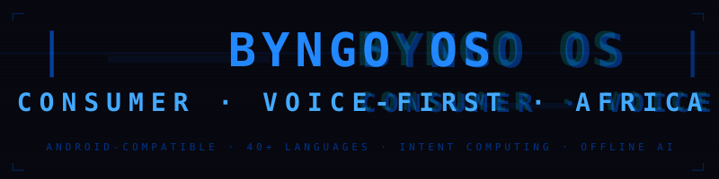
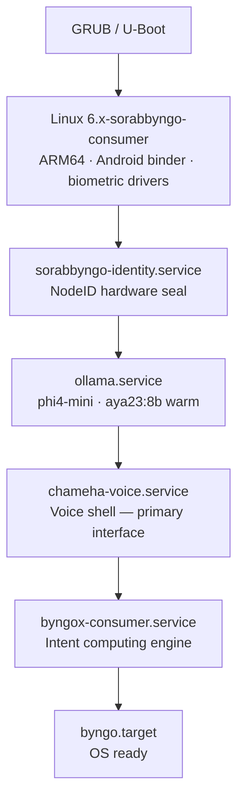

<p align="center">
  
</p>

---

The consumer surface of SORABBYNGO OS. Byngo OS powers phones, tablets, laptops, earbuds, and smartwatches across Africa. The AI is the interface — not an app you open.

---

## Boot sequence



---

## What makes it different

| Feature | How |
|---|---|
| Voice-first boot | Chameha boots to voice shell — no lock screen |
| No passwords | Continuous biometric — fingerprint + face |
| Intent computing | Say what you want, not which app to open |
| Android apps | ART runtime — existing Android APKs run |
| 40+ languages | Aya 23 — Swahili, Hausa, Yoruba, Amharic, Igbo + more |
| Offline AI | Phi-4 Mini always running — no cloud dependency |
| Mesh-native | Every device is a Byngonet node |

---

## Services

| Service | Role |
|---|---|
| `chameha-voice.service` | Primary voice shell — always listening |
| `byngox-consumer.service` | Intent engine — health, context, recommendation agents |
| `sorabbyngo-identity.service` | NodeID hardware seal at boot |
| `byngo.target` | Consumer OS target — boots to voice shell |

---

## Target devices

| Device | Arch | Status |
|---|---|---|
| Android phones | ARM64 | In development |
| Tablets | ARM64 | Planned |
| Laptops | x86_64 | Planned |
| Earbuds | ARM32 | Planned |
| Smartwatches | ARM64 | Planned |

---

## Build

```bash
# Requires sorabbyngo-os kernel source
export KERNEL_SRC=~/sorabbyngo-os
bash scripts/build.sh
```

---

## Part of SORABBYNGO OS

| OS Surface | Role |
|---|---|
| **Byngo OS** | Consumer devices — this repo |
| [Novela OS](https://github.com/sorabbyngo-os/novela-os) | Medical equipment |
| [Edge OS](https://github.com/sorabbyngo-os/edge-os) | IoT, drones, vehicles |
| [Server OS](https://github.com/sorabbyngo-os/server-os) | Infrastructure |
| [Sorabbyngo OS](https://github.com/sorabbyngo-os/sorabbyngo-os) | Kernel source |

---

<p align="center">
  <strong>Sorabbyngo Company</strong> &nbsp;·&nbsp; Kisii, Kenya &nbsp;·&nbsp; 2026<br/>
  <em>Rhythm of Digital Life</em>
</p>
